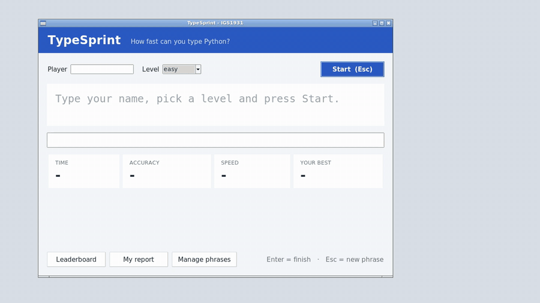

# TypeSprint

**A typing speed game with a tkinter GUI.** It's the example final project for *Software Programming (IGS1931)*, Inha University. Clone it, run it, read it, and use it as a reference for how to **build, organise and set up** your own team project.

You pick a name and a level and type the phrase you're shown. The phrase **colours itself as you type**: green is right, red is wrong. Press Enter to finish. TypeSprint measures your **time, accuracy and speed (WPM)**, saves every attempt, and makes a **leaderboard** and a **personal report with a chart**. You can manage the phrase bank in its own window.



*15-second demo ([MP4 version](docs/demo.mp4)).*

## How it meets the project requirements

| Requirement | Where to look |
|---|---|
| **File operation** | `phrases.py` reads/writes `data/phrases.txt`, `scores.py` appends to `data/scores.csv`, and `report.py` writes `reports/*.txt` |
| **Tkinter GUI** | `gui.py`: the main window, the leaderboard table, the report with a bar chart, and the phrase manager |
| **Functions** | every feature is a small function with a docstring and `return`, in `game.py`, `phrases.py`, `scores.py` and `report.py` |
| **Data management** | add / delete / filter / count phrases; save / load / filter results; each player's best result |
| **Report generation** | `reports/leaderboard.txt` and `reports/<name>_report.txt`, also shown in the app |

---

## 1. Setup (once per computer)

You need **Python 3.9 or newer, with tkinter**. Check that a small test window opens:

```bash
py -m tkinter            # Windows
python3 -m tkinter       # macOS / Linux
```

No window? Install tkinter:
- **Windows / macOS (python.org installer):** it's included. Reinstall and keep **"tcl/tk and IDLE"** ticked.
- **macOS with Homebrew Python:** `brew install python-tk`
- **Ubuntu / Debian:** `sudo apt install python3-tk`

### Get the code

```bash
git clone https://github.com/abdukarimovhm/typesprint.git
cd typesprint
```

### Make a virtual environment (venv)

A **venv** is a private box of Python packages for **this project only**, so different projects never fight over package versions. It lives in the `.venv` folder. That folder is **not** uploaded to GitHub (see `.gitignore`): every developer makes their own from `requirements.txt`.

| step | Windows (PowerShell / cmd) | macOS / Linux |
|---|---|---|
| create (once) | `py -m venv .venv` | `python3 -m venv .venv` |
| activate (every new terminal) | `.venv\Scripts\activate` | `source .venv/bin/activate` |
| install the packages | `pip install -r requirements.txt` | `pip install -r requirements.txt` |
| leave the venv | `deactivate` | `deactivate` |

When the venv is active, your prompt starts with `(.venv)`, and `python` means the venv's Python. In VS Code: *Ctrl/Cmd+Shift+P → Python: Select Interpreter →* pick the one inside `.venv`.

> **PowerShell says "running scripts is disabled on this system"?** Run this once, then activate again:
> `Set-ExecutionPolicy -Scope CurrentUser RemoteSigned`

## 2. Run it

```bash
python main.py
```

Type your name, pick a level, press **Start** (or **Esc**), type, and press **Enter**.

## 3. Run the tests

```bash
python -m pytest
```

Run it from the project folder. `python -m pytest` (instead of just `pytest`) makes sure Python finds `game.py` and the other modules.

---

## How the code is organised

```
typesprint/
├── README.md          this file: what it is, how to set it up and run it
├── LICENSE            who may use the code, and how (MIT)
├── docs/              the demo video for this README
├── requirements.txt   packages to install in the venv (only pytest: the game itself is standard library)
├── .gitignore         what git must NOT upload: .venv/, caches, your own scores and reports
├── main.py            start here: works out the file paths and opens the window
├── gui.py             the tkinter windows: widgets and handlers, nothing else
├── game.py            the rules: pick a phrase, accuracy, WPM, colouring, rating
├── phrases.py         the phrase bank: load, save, add, delete, filter, count
├── scores.py          every attempt: save, load, filter by player
├── report.py          leaderboard and player report: build the text, write the file
├── data/
│   ├── phrases.txt    the phrase bank, one  level|text  per line (edit it in any editor)
│   └── scores.csv     created automatically after the first round
├── reports/           the reports appear here
└── tests/             one test file per logic module
```

### The one rule: three layers

```
   gui.py                                        ← what the player sees and clicks
      │  calls functions
      ▼
   game.py · phrases.py · scores.py · report.py   ← the logic (no tkinter in here)
      │  read / write
      ▼
   data/  ·  reports/                             ← the files
```

- `gui.py` **never opens a file**. It asks `phrases.py`, `scores.py` or `report.py`.
- The logic modules **never import tkinter**, so they can be tested with plain `assert`s.
- `main.py` only connects the pieces.

Because the modules only talk to each other through functions, **five people can work at the same time** without breaking each other's code:

| Member | Module | Course topics used |
|---|---|---|
| A | `game.py` | strings, loops, `random`, arithmetic |
| B | `phrases.py` | files, `split`, lists of dictionaries |
| C | `scores.py` | files (append mode), CSV lines, `float()`, `time` |
| D | `report.py` | accumulators, `max` / `sum`, sorting, writing a report file, `os` |
| E | `gui.py` + `main.py` | tkinter and ttk, events, `after()` timer, `os.path` paths |
| everyone | `tests/` | `assert` |

## Using this as a reference for your own project

1. **Start with the layers.** Put your logic and file code in modules without tkinter, and keep the GUI in its own file.
2. **One module per team member**, and agree on the function names and what they return first.
3. **Build every path from `main.py`'s folder** (`os.path.dirname(os.path.abspath(__file__))`), so the app works from any folder.
4. **Write a test for each logic function** as soon as it works.
5. **Copy the repo skeleton:** `README.md`, `.gitignore`, `requirements.txt`, `data/`, `reports/`, `tests/`.
